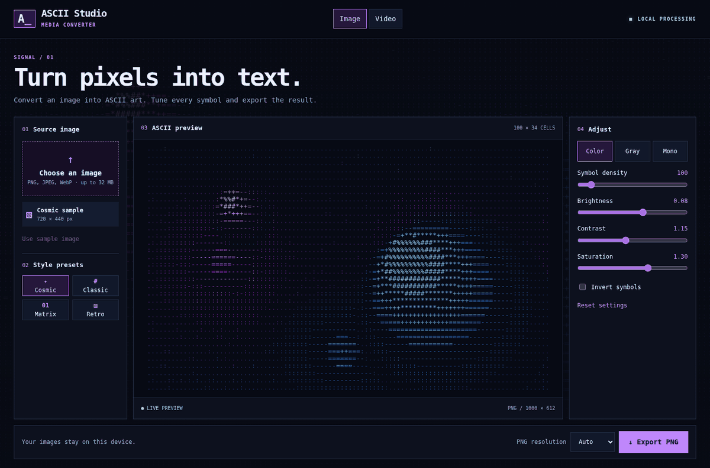
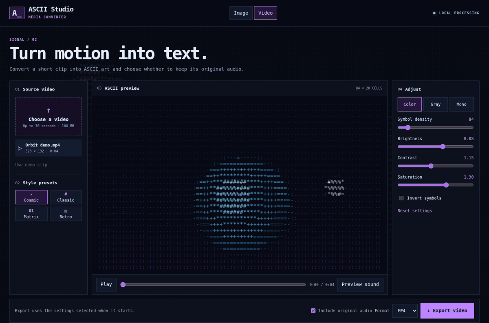

# ASCII Studio

A local image and video to ASCII converter. The web interface and the Android shell use the same React application and standalone TypeScript core.

## See it in action

Choose a style preset and adjust the image preview before exporting a PNG.



Preview a video as ASCII and change its style while it plays.



| Project | Purpose |
| --- | --- |
| apps/web | File selection, presets, Canvas preview, PNG and video export |
| packages/ascii-core | Reusable pixel-to-ASCII conversion |
| android | Capacitor app with native media saving through Android's document picker |

## Try on the web

With Node.js 24, run:

```sh
npm ci
npm run dev
```

Open the URL Vite prints. Try the built-in cosmic sample or choose a PNG, JPEG or WebP file. Adjust the ASCII preview and export a PNG. Switch to Video to preview a clip, seek, change styles and export MP4 or WebM with optional original audio. Input files stay on the device. `npm run build` creates the static site in `dist/`.

## Build Android

Use JDK 21 and Android SDK Platform 36 with Build Tools 36.0.0.

```sh
npm ci
npm run android:sync
cd android
./gradlew :app:assembleDebug
```

The debug APK is at `android/app/build/outputs/apk/debug/app-debug.apk` from the repository root. The GitHub Actions run also uploads a ZIP containing the APK. Open the synced Android project in Android Studio to install it on a test device. The document picker asks where to save the exported file.

## Implementation order

1. Build and test the core package in isolation. Verify that a separate project can install the packed package and import its API and TypeScript types.
2. Decode supported images locally to RGBA, bound the conversion input size, and pass the pixels to the core. Check sample rendering, custom settings, invalid files and PNG output.
3. Serve the same static build as a private web preview. Verify desktop and phone-sized layouts and the upload-to-export flow.
4. Bundle the web build in Capacitor. Compile an Android debug APK and verify file selection, conversion, saving and cancellation on a physical device before release.
5. Decode and preview local video clips. Export in real time using the device’s available MP4 or WebM encoder. Show progress and allow cancellation, then save through the browser or Android document picker.
6. Verify playback, seeking, cancellation and exported files on desktop and Android before expanding the clip limits.

Run `npm test` to check the conversion core. [Architecture](ARCHITECTURE.md) and [core integration](packages/ascii-core/README.md) describe the design and API.

## Video limits

- Clips must be at most 30 seconds and 100 MB. Input decoding depends on the browser or Android WebView.
- The export format list is based on encoder support. A device may be able to preview a clip even if its browser or WebView cannot encode it.
- Export runs in real time. Turn off **Include original audio** to create a file without an audio track. Playback sound can be toggled separately. Keep the app visible until export finishes. Capture targets up to 24 FPS, and actual frame rate depends on the device and source.
